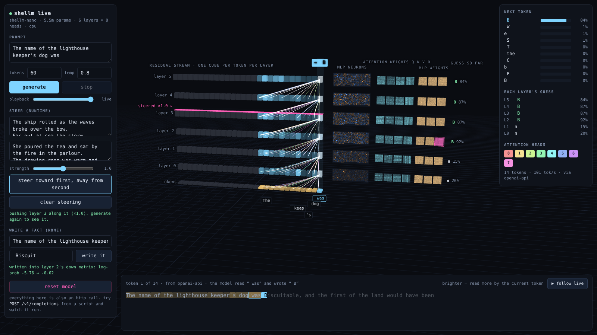

# shellm

your own llm, built from scratch, that runs locally in pretty much every format,
and that you improve by **programming its weights directly**.

```
corpus ─▶ tokenizer ─▶ pretrain ─▶ base ──┐
                        finetune ─▶ skills ┤  weight-space programs   ┌─▶ hf safetensors  (transformers, mlx, vllm)
                     lora on your text ────┤  (merge, edit, steer,  ──┼─▶ gguf f16/q8/q4  (llama.cpp, ollama, lm studio)
                                           │   compress, surgery)     ├─▶ onnx            (onnxruntime: py/js/c#/c++/browser)
                                           └──────────▶ your model ───┴─▶ npz + 1 file    (pure numpy, runs anywhere)
```

## install

you need python 3.10+ and git.

```bash
# macOS / Linux
git clone -b claude/relaxed-lovelace-m1efbk https://github.com/ArthurJClack/clack
cd clack && ./install.sh
```

```powershell
# Windows (PowerShell)
git clone -b claude/relaxed-lovelace-m1efbk https://github.com/ArthurJClack/clack
cd clack; powershell -ExecutionPolicy Bypass -File install.ps1
```

then open a new terminal and run `shellm`. the installer makes a private python
environment in `~/.shellm`, so nothing else on your machine changes, and it bundles the
trained model, so there is nothing to download or train first. the core install is four
packages (torch, numpy, tokenizers, safetensors). run the installer again to update.

no installer: `pip install -r requirements.txt` then `python -m shellm`.

## the terminal app

```
╭──────────────────────────────────────────────────────────────────────╮
│ ◆ shellm v0.2.0                                                      │
│                                                                      │
│ model     shellm-nano · 5.5m params · 6 layers · cpu                 │
│ workspace ~/shellm-workspace                                         │
│                                                                      │
│ type the start of some text and it writes what comes next.           │
│ it is a small model that continues text. it cannot chat.             │
╰──────────────────────────────────────────────────────────────────────╯
  /help for commands · /do to give it a pc task · /viewer to watch it think in 3d

─────────────────────────────────── shellm-nano · 80 tokens · temp 0.8 ─
> It was a cold morning when Holmes
● It was a cold morning when Holmes went away for the moment, and he looked at the
  coolness and the air which was already lost by the dining-room.
  30 tokens · 264 tok/s · enter to keep going

> /do make a folder called reports and put a file notes.txt in it that says hello world
● plan (2 actions in ~/shellm-workspace)
    1  mkdir reports
    2  write reports / notes.txt hello world

  run this? [y] yes   [n] no   [a] yes, and stop asking this session
```

| command | what it does |
|---|---|
| any text | the model continues it. plain enter keeps going |
| `/do <instruction>` | pc task: it writes a plan of file actions, you approve, it runs in the workspace |
| `/fact <start> => <answer>` | write a fact into the weights, live |
| `/steer <toward> \| <away>` | push the writing style; `/steer off` |
| `/viewer` | open the 3d view of the model in your browser; the terminal and the view share one model |
| `/reset`, `/state`, `/save <dir>` | undo edits, list them, keep them |
| `/tokens N`, `/temp X`, `/seed N` | length, randomness, repeatable runs |

`shellm -p "some text"` prints one continuation and exits, for scripts.

## pc tasks: teaching it to do things

the model learns a small action language for files and folders, and everything it writes
is run by a sandbox, never by a shell:

```
task: make a folder called reports and put a file notes.txt in it that says hello world
> mkdir reports
> write reports / notes.txt hello world
.
```

- **actions:** `mkdir write append read list count copy move delete find`. they are plain
  python, work the same on windows, mac and linux, and cannot touch anything outside one
  workspace folder (`~/shellm-workspace` by default; absolute paths, `..` and symlinks out
  are refused).
- **tasks:** 16 families (make a folder, write a file, rename, back up, count lines, ...),
  each with several wordings. `shellm tasks list` shows them.
- **grading by doing:** the model's plan and a reference plan are each run in a fresh
  sandbox. a task passes only if both leave identical files and print identical output.
- **nothing runs without you:** `/do` shows the plan and waits for a yes.

```bash
shellm tasks eval             # grade the bundled skill: 3 kinds of test
shellm tasks train --install  # retrain it yourself (about 25 min on 4 cpu cores)
shellm do "rename draft.txt to final.txt"
```

_scores: the skill is being retrained; numbers land in the next commit._

add your own task: one entry in `shellm/tasks/suite.py` (wordings + the reference
actions), then retrain.

## see it think: live 3d viewer + api

```bash
shellm serve      # then open http://127.0.0.1:8000   (or /viewer inside the terminal app)
```



the page shows the model's real parts while it runs, one token at a time:

- **wall** = the residual stream, one cube per token per layer (brighter = bigger)
- **arcs** = attention: which earlier tokens the current token is reading, one colour per head
- **panels** = that layer's mlp neurons firing (orange positive, blue negative)
- **tiles** = the layer's weight matrices; a tile turns pink when you edit it
- **guess so far** = what each layer would say if the model stopped there

in the screenshot a fact was just written in ("...keeper's dog was" → " Biscuit"). layers
0-1 still guess "n"; from layer 2, the edited one, every layer says "B".

you can steer, write facts and reset from the page. the view is fed by a server event
stream, so **anything that uses the api shows up live**, not only what you type there.
drag to orbit, scroll to zoom, double-click to re-centre, click a word to rewind to it.
it works offline (three.js is vendored).

### use it from code

```python
from shellm.api import Session                      # in-process, no server

s = Session()                                      # the bundled model; or Session("path/or/name")
print(s.complete("The old house on the hill", max_tokens=40, seed=1))
for ev in s.generate("Once upon a time", max_tokens=20, trace=True):
    if ev["type"] == "token":
        t = ev["trace"]        # numpy: attn [layers, heads, ctx], mlp [layers, ffn], lens, top
s.edit("The name of the lighthouse keeper's dog was", " Biscuit")   # rome, live, ~5s
s.steer(pos=["the sea, the ship"], neg=["the parlour, the tea"], alpha=1.0)
s.reset()
```

```python
from shellm.client import Client                    # same thing over http

c = Client("http://127.0.0.1:8000")
c.complete("It was a cold morning when", max_tokens=30)
```

```bash
# openai-compatible, so existing sdks and tools work by changing the base url
curl http://127.0.0.1:8000/v1/completions -H 'Content-Type: application/json' \
  -d '{"prompt": "It was a cold morning when", "max_tokens": 30}'
```

| route | what |
|---|---|
| `POST /v1/completions`, `POST /v1/chat/completions`, `GET /v1/models` | openai-compatible (streaming too). chat messages are flattened to text |
| `POST /api/generate` | `{prompt, max_tokens, temperature, top_k, top_p, seed, stop, stream, trace}` |
| `GET /api/events` | server-sent events for every generation, steer and edit (what the viewer watches) |
| `GET /api/model`, `GET /api/state`, `GET /api/weights?name=` | architecture, live edits, a picture of a weight matrix |
| `POST /api/steer`, `DELETE /api/steer`, `POST /api/edit`, `POST /api/reset` | reprogram the running model |

the server uses only the standard library, binds to 127.0.0.1, and refuses cross-origin
browser requests unless you pass `--cors`.

## the plan

1. **model**: a decoder-only transformer that is *exactly* llama (rmsnorm, rope, swiglu,
   grouped-query attention, tied embeddings, no biases). parameter names match huggingface's
   `LlamaForCausalLM` 1:1, so the state dict *is* an hf checkpoint and every runtime that
   speaks llama loads it without custom code. sizes from `nano` (5m, trains on a laptop cpu)
   to `base` (~200m, wants a gpu). see `shellm/config.py`.
2. **tokenizer + data**: byte-level bpe trained on your corpus (gpt-2 style, so llama.cpp
   understands it natively). default corpus is ~750 public-domain books. your own writing goes
   in `data/personal/` and becomes a personal lora.
3. **formats**: one checkpoint exports to hf / gguf (+ ollama modelfile) / onnx / npz, and
   `--verify` checks each one against the torch logits using the *real* runtimes
   (transformers, llama.cpp, onnxruntime, numpy).
4. **weight-space programming (wsp)**: models are values. subtract them to get task vectors,
   add/scale/merge them, write facts in with closed-form rank-one edits, find concept
   directions and bake or erase them, compress and rearrange layers. programs are plain
   python "recipes" and every saved model records the recipe that built it.
5. **demo**: base model (never saw jane austen or conan doyle), two skill finetunes, then
   recipes that merge, edit, steer and compress, measured on held-out text at every step.

## quickstart

```bash
pip install -r requirements-extra.txt   # adds the export + verify tools
bash scripts/build_demo.sh              # everything, ~1h on 4 cpu cores
```

or step by step:

```bash
python -m shellm tokenizer --src corpus/books --vocab 4096 --out runs/tok.json
python -m shellm data   --src corpus/books --src data/personal:20 --tokenizer runs/tok.json --out runs/data/mix
python -m shellm train  --data runs/data/mix --out runs/base --preset nano --steps 2500
python -m shellm sample runs/base/last "The old house on the hill"
python -m shellm wsp    recipes/03_edit_facts.py
python -m shellm export runs/base/last --out dist/shellm --quant f16,q8_0,q4_0 --verify
python -m pytest tests -q
```

`--src dir:20` repeats a source 20x so a small personal folder isn't drowned out.

### run it anywhere

| format | file | run it with |
|---|---|---|
| gguf | `dist/shellm/gguf/shellm-q8_0.gguf` | `llama-cli -m shellm-q8_0.gguf -p "Once"`, lm studio (drag it in), koboldcpp, jan |
| ollama | `dist/shellm/gguf/Modelfile` | `ollama create shellm -f Modelfile && ollama run shellm` |
| hf | `dist/shellm/hf/` | `AutoModelForCausalLM.from_pretrained("dist/shellm/hf")`, `mlx_lm.generate --model dist/shellm/hf` |
| onnx | `dist/shellm/onnx/shellm.onnx` | onnxruntime in python / node / c# / browser (`onnxruntime-web`) |
| numpy | `dist/shellm/numpy/shellm.npz` + `shellm_numpy.py` | `python shellm_numpy.py shellm.npz "Once"` (needs only numpy) |
| lora | `runs/*/adapter-last/` | peft format, so hf peft and llama.cpp `convert_lora_to_gguf.py` read it |

this is a *base* (completion) model: give it the start of some text and it continues. it
doesn't follow instructions or chat.

## weight-space programming

```python
from shellm.wsp import *

base   = load("runs/base/last")              # native ckpt, hf dir, or a peft adapter (-> delta)
austen = load("runs/austen/last")
tv     = austen - base                       # task vector (kind="delta")
m      = base + 0.8 * tv                     # apply a skill at 80%
m      = base - tv                           # ...or subtract it (unlearning)
m["*.mlp.*"]                                 # glob sub-selection -> Weights
m.layer(3), m.stats(), tv.norm(), tv.cosine(tv2)

linear([a, b], [.5, .5])                     # soup
slerp(a, b, 0.5)
ties(base, [a, b], density=0.5)              # trim, elect sign, disjoint mean
dare_ties(base, [a, b], p=0.9)
interference([tv1, tv2])                     # cosine + sign-conflict rate

m = rome(m, Fact("The captain's horse was named", " Gearheart"), layer=2, data="runs/data/base")
m = edit_many(m, [fact1, fact2, ...], layers=[2], data=...)
fact_logprob(m, m.tok(), prompt, target)

v = steering_vector(m, pos_texts, neg_texts, layer=3)
m.generate("She opened the door", steering={3: 1.0 * v})   # runtime
m, fit = bake_steering(m, 3, 1.0 * v, data)                # permanent, survives export
m = ablate_direction(m, v)                                  # can no longer write v at all

low_rank(m, energy=0.9); prune(m, 0.5); fake_quant(m, bits=4)
stack_layers(m, [0, 1, 2, 2, 3, 4, 5]); splice(a, b, 3); transplant(a, b, "*.mlp.*")

m.generate("Once upon a time", 80)
m.save("runs/mine")                          # -> python -m shellm export runs/mine ...
m.export("dist/mine")                        # or straight to every format
```

binary ops take the union of keys, and a missing key counts as zero, so a delta that only
touches some tensors (a lora, a rome edit) adds cleanly onto a full model.

### how the tricky ones work

- **rome** (`wsp/edit.py`): the mlp down-projection works as a key→value memory. we take
  the key `k*` (the mlp activation at the subject's last token, averaged over a few random
  prefixes), search for an output `v*` that makes the target likely (adam on one vector,
  norm-clamped), then apply the smallest weight change that maps `k*` to `v*`, measured
  under the covariance `C` of ordinary keys: `W += (v* - W k*)(C⁻¹k*)ᵀ / (k*ᵀC⁻¹k*)`.
  that's rank one, touches one tensor, and the weights never get a gradient.
- **baked steering** (`wsp/steer.py`): llama has no biases, so you can't just add a
  constant vector. instead we solve a ridge regression for `ΔW = v aᵀ` on a down_proj so
  that `ΔW k ≈ v` for typical keys `k`. `fit` reports the mean and spread of that gain.
- **ablation**: project the direction out of every matrix that writes to the residual
  stream (embeddings, o_proj, down_proj). after that the model can't represent it at all.

### recipes

| recipe | what it shows |
|---|---|
| `01_task_vectors.py` | skills as vectors: add, scale, subtract; λ sweep |
| `02_merges.py` | linear vs slerp vs task arithmetic vs ties vs dare-ties |
| `03_edit_facts.py` | rome fact edits + paraphrase generalization + general-loss check |
| `04_steering.py` | concept direction → runtime steering → baked → ablated |
| `05_compress.py` | svd / pruning / n-bit sweeps before you pick an export quant |
| `06_layer_surgery.py` | drop / repeat blocks, splice and transplant between finetunes |
| `99_build_personal.py` | the final program that assembles your model |

`python -m shellm info runs/shellm-personal` prints the recipe and the hash it was built from.

## results (the committed demo model)

all numbers are val loss on held-out text (lower is better), from `scripts/build_demo.sh`
on a 4-core cpu. the base model is `nano` (5.5m params, 2500 steps / 20m tokens, ~50 min):
loss 8.35 → 3.72 (ppl 41). austen and conan doyle were **excluded** from its training data.

**task vectors** (`01`): the two skill vectors are nearly orthogonal (cosine 0.03).

| model | austen | doyle | general |
|---|---|---|---|
| base | 3.868 | 3.757 | 3.696 |
| base + austen | 3.542 | 4.020 | 4.002 |
| base + doyle (lora) | 4.016 | 3.563 | 3.827 |
| **base + 0.5·(austen + doyle)** | **3.652** | **3.666** | 3.807 |
| base − austen ("unlearn") | 5.039 | 4.338 | 4.286 |

**merges** (`02`): linear 50/50 won (avg 3.708 vs 3.774 base). slerp tied it, at 3.709.
ties ended up slightly worse: it resolves sign conflicts, and orthogonal task vectors barely
have any. dare at p=0.9 wrecked the model (5.37). its 10× rescale assumes tiny, redundant
deltas, which holds for 7b finetunes but not for a 5m model.

**rome fact edits** (`03`): one rank-one update per target token, all in one tensor.

| fact | logp before | logp after |
|---|---|---|
| …machines called → " shells" | −4.31 | −0.02 |
| …horse was named → " Gearheart" | −8.10 | −0.02 |
| …lighthouse was → " lantern" | −4.09 | −0.01 |
| paraphrase: "…the machines that fought the war were called" | −3.93 | −0.03 |

general loss went 3.696 → 3.727, but that number hides a real cost: on a model this small
the edits leak. with the three facts written in, 20 short samples from 5 unrelated
prompts contained 11 stray "lantern / shells / Gearheart" mentions (0 before). anchoring
the edit to the subject word stops the leak but then the fact doesn't stick (logp −2 to
−7), and no layer avoids the trade-off. so the committed model ships **without** baked-in
facts: write them live in the viewer or with `Session.edit`, and `reset` when done.

**steering** (`04`): the "sea vs home" direction at layer 3 visibly changes the text at
α=1. baked into the weights with no hooks, the generation matches the runtime-steered one
token for token for the first ~10 tokens (gain 0.94 ± 0.23). ablating the direction
sets the sea score of neutral text to exactly 0, for +0.02 loss.

**compression** (`05`): 8-bit +0.0001, 4-bit +0.015, 3-bit +0.10, prune 30% +0.014,
svd at 90% energy +0.10 (the weights aren't low-rank).

**surgery** (`06`): block 0 is essential (dropping it gives 7.66), blocks 2-3 are the most
redundant (+0.15 each).

**final model** (`99`): the linear merge → austen 3.652, doyle 3.666, general 3.807.
verified exports: hf / gguf-f16 / onnx / npz within 0.003 of torch with identical top-1;
gguf q8_0 and q4_0 agree on top-1 for 96% of positions.

### try the committed model

```bash
shellm                                                         # the terminal app
shellm serve                                                   # viewer + api
shellm sample shellm-nano "It was a cold morning when Holmes"
shellm export shellm-nano --out dist/shellm --verify           # every other format (needs requirements-extra.txt)
cd dist/shellm/gguf && ollama create shellm -f Modelfile && ollama run shellm "It was a cold morning when Holmes"
```

## bigger models on your own machine

`--device auto` picks cuda (also amd on rocm builds of torch) → mps → cpu.

- **rx 6600 xt (8gb)**: on linux, install the rocm build of torch and
  `export HSA_OVERRIDE_GFX_VERSION=10.3.0` (gfx1032 isn't officially supported, but the
  override works). `PRESET=small STEPS=20000 BATCH=32 bash scripts/build_demo.sh` fits
  easily; `base` (~200m) fits with `--dtype float16 --batch-size 8 --grad-accum 4`.
- **cpu only (e.g. ryzen 7 5800x3d)**: about 2-3x this repo's 4-core numbers. `micro` is a
  good overnight run.
- bump `VOCAB` with the preset (`small`: 16384, `base`: 32000).

## layout

```
shellm/
  config.py model.py tokenizer.py data.py train.py lora.py io.py evaluate.py cli.py
  api.py server.py client.py      Session (python api), http server, http client
  tui.py                          the terminal app
  tasks/                          pc tasks: sandboxed actions, task families, training, grading
  viz/static/                     the 3d viewer (three.js vendored, MIT)
  models/                         bundled: shellm-nano (base) and shellm-nano-pc (with the pc skill)
  export/  hf.py gguf.py onnx.py numpy_rt.py verify.py
  wsp/     tensors.py merge.py edit.py steer.py surgery.py recipe.py
recipes/   weight-space programs
scripts/   build_demo.sh
tests/     fast end-to-end tests on a tiny model (all formats, all wsp ops, api + server)
install.sh install.ps1   one-step installers
```
